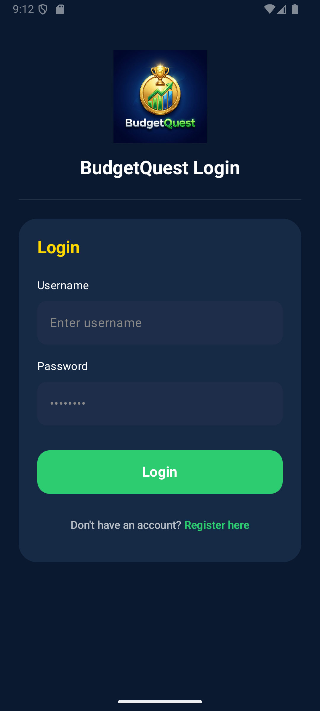
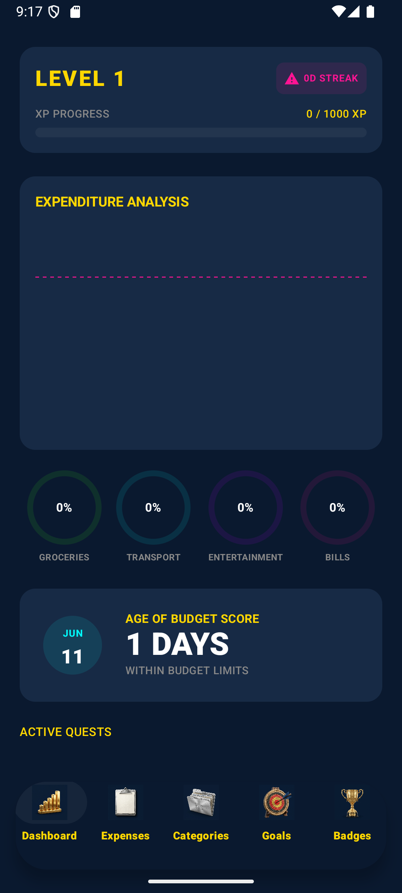
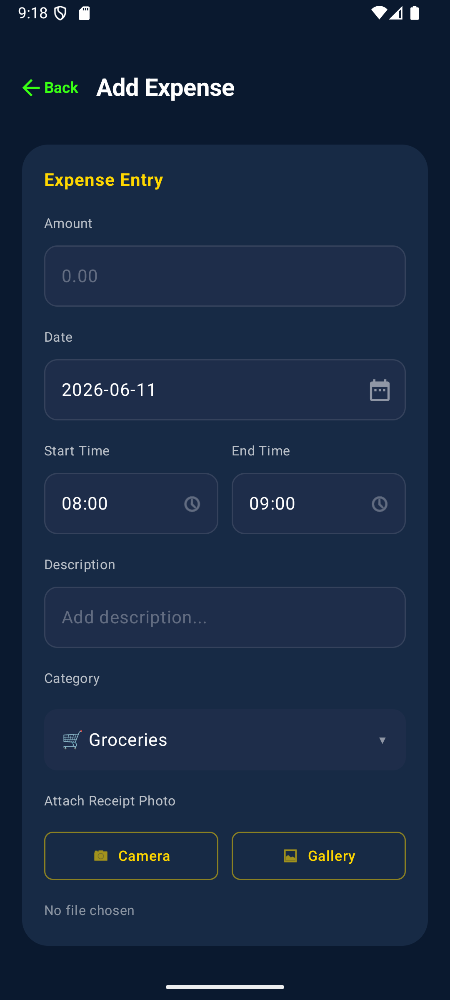
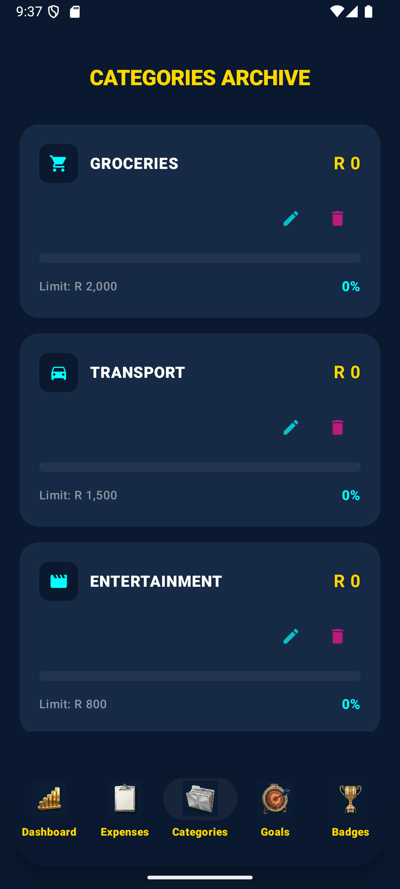
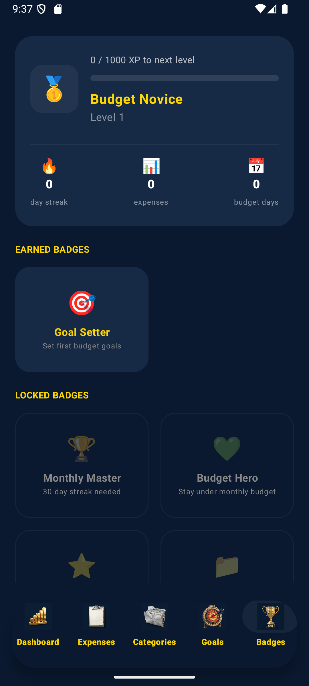

<p align="center">
  
</p>

<h1 align="center">BudgetQuest</h1>

<p align="center">
  <a href="https://github.com/RayMambani/group-assignment/actions/workflows/build.yml">
    
  </a>
</p>

BudgetQuest is a personal finance management application for Android, built with a **"Cyber-Noir"** design language. It turns the often-tedious habit of expense tracking into a game: users earn experience points (XP), climb levels, build daily streaks, and unlock achievement badges as a reward for staying on top of their money. The goal is behavioural — make consistent budgeting feel rewarding rather than like a chore.

---

## 1. Purpose of the App

Most people abandon budgeting apps because logging expenses feels like admin with no payoff. BudgetQuest addresses this directly:

* **Make tracking habitual** — every logged expense grants XP and extends a daily streak, borrowing proven engagement loops from mobile games.
* **Make budgets visible** — a real-time dashboard shows exactly how much of each category's monthly limit has been used.
* **Make progress tangible** — levels, rank titles ("Budget Novice" → "Financial Expert") and badges give users a long-term sense of growth.

The app is fully **offline-first**: all data lives in a local database on the device, so there is no account server, no network dependency, and no privacy trade-off.

## 2. Key Features

| Feature | Description |
| --- | --- |
| **Centralized Dashboard** | Real-time expenditure analysis, budget utilisation metrics, and category spending charts. |
| **Expense Management** | Fast entry for logging daily transactions, filterable by date range. |
| **Budget Categorization** | Dynamic categories with monthly limits and progress visualisation (limited to four focus categories). |
| **Gamified Achievements** | XP, levels, daily streaks and badges driven by the spending behaviour itself. |
| **Quests** | Goal-style challenges (e.g. "Log expenses for 5 days straight") that reward sustained engagement. |
| **Secure Local Accounts** | Username/password login with BCrypt-hashed credentials stored on-device. |

---

## ⭐ Our Own Custom Features (what the marker should look for)

Beyond the core budgeting requirements, our team designed and built the following **two custom features**. These are the features described in our design document and are the ones we want the lecturer to focus on.

### Feature 1 — Gamified Progression System (XP, Levels, Streaks & Badges)
Instead of being a plain expense tracker, BudgetQuest turns budgeting into a game. Every action the user takes feeds a complete progression system:

* **XP & Levels** — logging an expense awards **+50 XP**; every 1000 XP advances the user a level, and each level maps to a themed rank title (**Budget Novice → Frugal Squire → Finance Knight → Financial Expert**).
* **Daily Streaks** — logging on consecutive days builds a streak, with bonus rewards at 7-day and 30-day milestones; missing a day resets it.
* **Achievement Badges** — badges such as *Goal Setter*, *Monthly Master* and *Budget Hero* unlock as the user hits behavioural targets.

**Where to see it in the app:** the Dashboard header (level + XP bar + streak), the **Badges** tab, and the XP toast shown after adding an expense.
**Where to see it in the code:** the scoring rules live in the stateless [GamificationEngine.kt](app/src/main/java/com/budgetquest/app/domain/GamificationEngine.kt) (unit-tested in [GamificationEngineTest.kt](app/src/test/java/com/budgetquest/app/domain/GamificationEngineTest.kt)); the XP/streak award logic on each expense is in [MainViewModel.addExpenseWithXP()](app/src/main/java/com/budgetquest/app/ui/viewmodel/MainViewModel.kt); the badge UI is in [BadgesScreen.kt](app/src/main/java/com/budgetquest/app/ui/screens/badges/BadgesScreen.kt).

### Feature 2 — Visual Progress Rings (colour-coded spending health)
Each budget category is shown as an animated **circular progress ring** that fills up as the user spends against that category's monthly limit. The ring is more than decorative — its **colour is a live spending-health indicator**:

* **Green** — safe (under 80% of the limit).
* **Orange** — warning (80%–99% of the limit).
* **Red** — over budget (100% or more).

The percentage spent is drawn in the centre of each ring, and the fill **animates smoothly** to the new value whenever spending changes, giving instant at-a-glance feedback without the user having to read any numbers.

**Where to see it in the app:** the **Dashboard** (a ring per category) and the **Categories** tab.
**Where to see it in the code:** the ring is a custom Compose component, [`ProgressRing` in ProgressComponents.kt](app/src/main/java/com/budgetquest/app/ui/components/ProgressComponents.kt), drawn with `Canvas`/`drawArc`, animated via `animateFloatAsState`, with the green/orange/red thresholds chosen from the `progress` value; the per-category percentages it renders are computed in [MainViewModel.kt](app/src/main/java/com/budgetquest/app/ui/viewmodel/MainViewModel.kt).

> The full feature catalogue (6 features in total) is also browsable in-app via the **"View All Features"** button on the Dashboard, implemented in [FeaturesScreen.kt](app/src/main/java/com/budgetquest/app/ui/screens/features/FeaturesScreen.kt).

## 3. Design Considerations

### 3.1 Visual Design — "Cyber-Noir"
The interface uses a dark, high-contrast palette with neon accents (cyan, purple, pink, green) defined centrally in [Color.kt](app/src/main/java/com/budgetquest/app/ui/theme/Color.kt). A consistent theme is applied through [Theme.kt](app/src/main/java/com/budgetquest/app/ui/theme/Theme.kt), so colour and typography choices live in one place and the whole app restyles from a single source.

### 3.2 Architecture — MVVM + Repository
The codebase follows a clean, layered **MVVM** structure so that UI, logic, and data are independent and testable:

```
UI (Jetpack Compose screens)
        │  observes StateFlow
ViewModel (AuthViewModel, MainViewModel)   ← UI state + actions
        │  calls suspend functions
Repository (AuthRepository, ExpenseRepository)  ← single source of truth
        │  Room DAO
Local Database (Room / SQLite)
```

* **Reactive data flow** — the UI never asks for data; it *observes* Kotlin `Flow`/`StateFlow` streams. When the database changes, the screen updates automatically. See [MainViewModel.kt](app/src/main/java/com/budgetquest/app/ui/viewmodel/MainViewModel.kt), where every stream is derived from the logged-in user with `flatMapLatest`.
* **Separation of concerns** — repositories are the *only* code that touches the database, so the gamification and UI layers stay free of persistence details.
* **Pure, testable logic** — scoring rules live in a stateless [GamificationEngine](app/src/main/java/com/budgetquest/app/domain/GamificationEngine.kt) object and are covered by [GamificationEngineTest](app/src/test/java/com/budgetquest/app/domain/GamificationEngineTest.kt).

### 3.3 Security
Passwords are **never stored or logged in plain text**. The [AuthRepository](app/src/main/java/com/budgetquest/app/data/repository/AuthRepository.kt) hashes every password with **BCrypt** (a deliberately slow, salted algorithm) and only ever compares hashes — even our own logging deliberately omits credential values.

### 3.4 Logging
The app uses Android's `android.util.Log` throughout the data and ViewModel layers to make its behaviour observable in Logcat. Each class declares its own `TAG`, and log levels are used intentionally:

* `Log.i` — significant lifecycle events (app start, successful login/registration, XP awarded).
* `Log.d` — routine operations (inserting an expense, applying a date filter).
* `Log.w` — recoverable problems (empty form fields, failed login, duplicate username).

For example, logging in produces a clear trail:
```
I/BudgetQuestApp: BudgetQuest application started and dependency graph initialised
D/AuthViewModel: login() submitting for 'demo'
D/AuthRepository: login() attempt for username='demo'
I/AuthRepository: login() succeeded for 'demo'
I/AuthViewModel: login() success for 'demo'
```

### 3.5 App Icon & Image Assets
The app ships with a custom **adaptive launcher icon** (the BudgetQuest trophy logo), defined in [mipmap-anydpi-v26/ic_launcher.xml](app/src/main/res/mipmap-anydpi-v26/ic_launcher.xml) with a separate foreground ([ic_launcher_logo_foreground](app/src/main/res/drawable/ic_launcher_logo_foreground.xml)) and background layer, plus a round variant for launchers that request one. It is wired up in the manifest via `android:icon` and `android:roundIcon`.

Final in-app image assets are kept in [app/src/main/res/drawable/](app/src/main/res/drawable/): the `app_logo` used on the splash/auth screens, and two complete sets of bottom-navigation icons — a flat set (`ic_nav_*`) and a skeuomorphic set (`ic_skeuo_*`) for the Dashboard, Expenses, Categories, Goals and Badges tabs.

## 4. Technical Stack

| Concern | Technology |
| --- | --- |
| Language | Kotlin |
| UI | Jetpack Compose (declarative) |
| Architecture | MVVM + Repository pattern |
| Dependency Injection | Hilt (Dagger) |
| Persistence | Room (SQLite) |
| Concurrency | Kotlin Coroutines + StateFlow |
| Password hashing | BCrypt (jBCrypt) |
| CI/CD | GitHub Actions |

## 5. Use of GitHub

This project is developed and submitted entirely on **GitHub**:

* **Source control** — the complete Kotlin source is version-controlled and pushed to GitHub (no zip files), giving the team a shared history and the ability to track every change.
* **Collaboration** — group members work against the same `main` branch, with commits documenting each feature and fix.
* **Documentation** — this README lives in the repository so the documentation travels with the code.

## 6. Use of GitHub Actions (CI/CD)

The repository uses **GitHub Actions** for Continuous Integration. The workflow is defined in [.github/workflows/build.yml](.github/workflows/build.yml) and runs automatically on every push and pull request to `main` (and can also be triggered manually via `workflow_dispatch`).

On each run the pipeline:

1. **Checks out** the repository.
2. **Sets up JDK 17** (Zulu distribution) with Gradle caching to speed up builds.
3. **Builds the Debug APK** with `./gradlew assembleDebug` — this acts as an automated check that the code compiles and the app assembles successfully on a clean machine.
4. **Uploads the APK** as a downloadable build artifact, named with the build date.

This means every change is automatically verified to build, and a ready-to-install APK is always available straight from the Actions tab — no local setup required for reviewers.

## 7. Development Setup

### Prerequisites
* Android Studio (Flamingo 2022.2.1 or newer)
* JDK 17
* Android SDK Level 26 (minimum)

### Installation and Execution
1. **Clone the repository**
   ```bash
   git clone https://github.com/RayMambani/group-assignment.git
   ```
2. **Open in Android Studio** and let Gradle synchronise the dependencies.
3. **Run** on a connected device or emulator:
   ```bash
   ./gradlew installDebug
   ```

> **Note:** `local.properties` (your local Android SDK path) is machine-specific and intentionally not committed. Android Studio generates it automatically on first open.

## 8. Screenshots

Captured from the app running on an Android emulator.

| Login | Dashboard | Add Expense |
| --- | --- | --- |
|  |  |  |

| Categories | Badges & Ranks |
| --- | --- |
|  |  |

## 9. Project Contributors

* **Ray Mambani** — Project Lead
* **Sandisiwe Manyathi** — Group Member
* **Kefilwe Mogano** — Group Member

## 10. Video Presentation

A full walkthrough of the app's features is available here:

▶️ **https://youtu.be/a8E8j25oy9k?si=neyjzFO6btsq2sdh**

## 11. Licensing

This project is licensed under the MIT License. See the [LICENSE](LICENSE) file for details.
